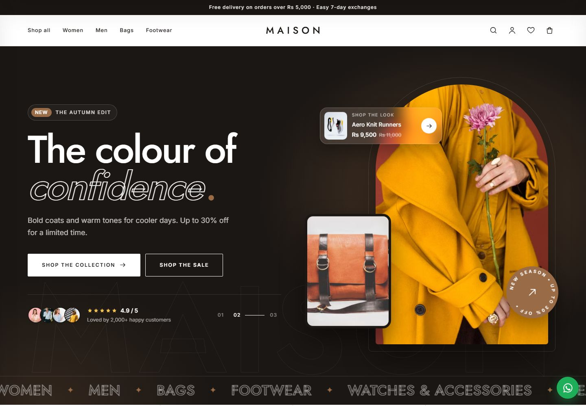
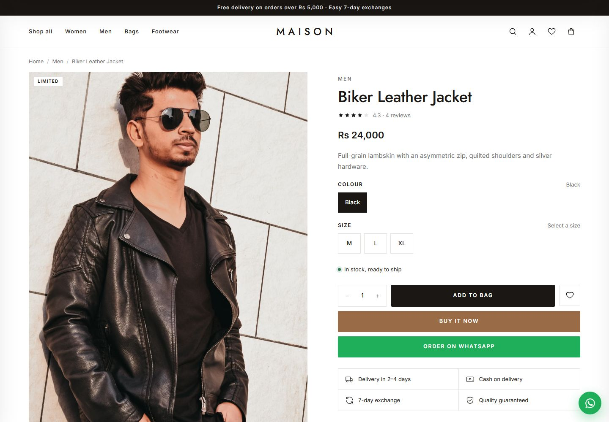
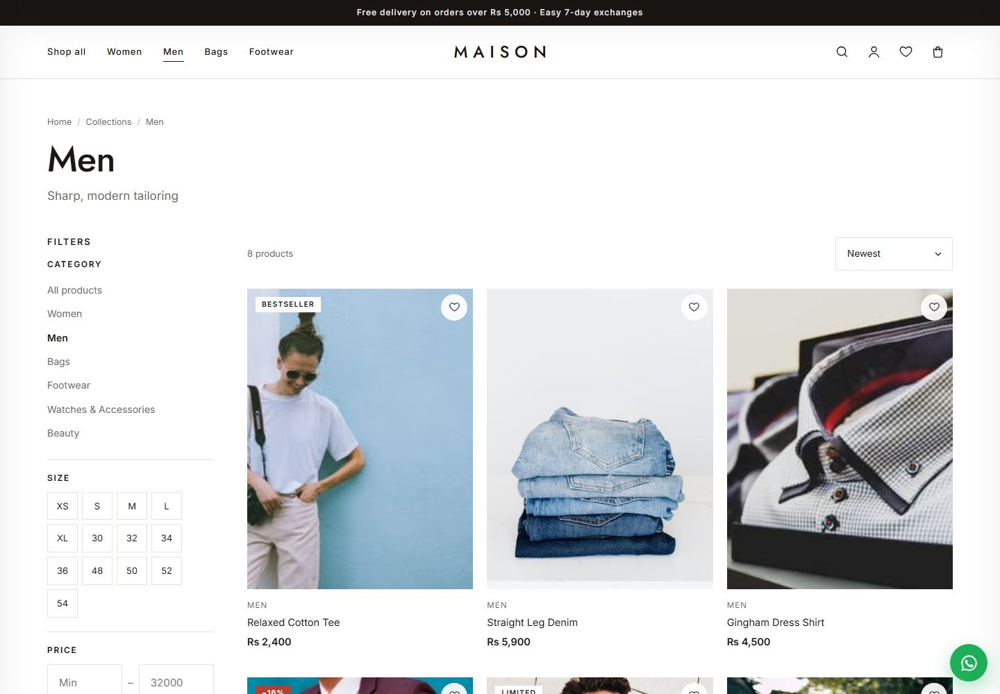
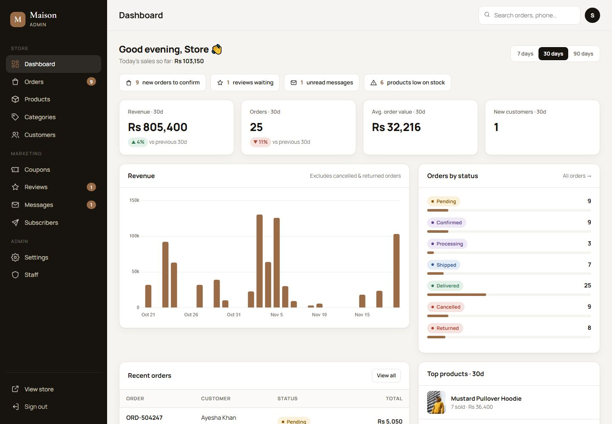
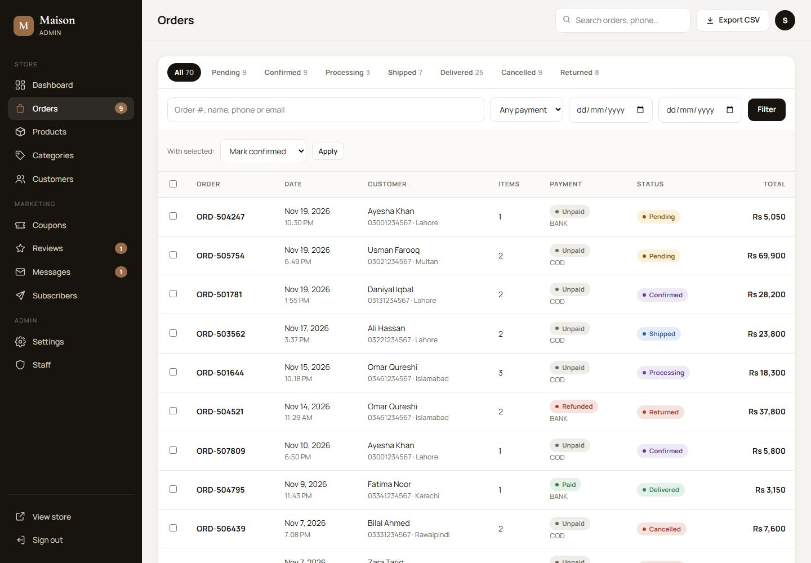
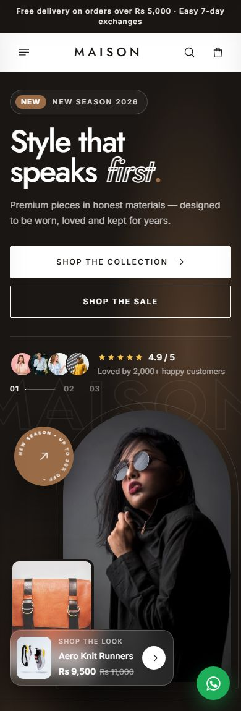

<div align="center">

# Premium E‑Com Store

**A premium, white‑label online store with a full admin dashboard.**
Change the settings, add products, and a new brand's store is live, with no code changes.




</div>

---

## About

Premium E‑Com Store is a ready-to-launch online store for fashion and lifestyle brands. A boutique can be selling the same day:

- **Storefront:** an editorial, premium design that is fully responsive (phone, tablet and desktop) and covers the whole path from browsing to checkout to order tracking.
- **Admin dashboard:** day-to-day running of the store: orders, products, customers, coupons, reviews, messages and settings.
- **White-label by design:** store name, logo, brand colours, homepage content, contact details, delivery fees and payment methods are all edited from **Admin → Settings**.

It is built for the way small online stores sell in markets like Pakistan: **cash on delivery**, bank transfer, WhatsApp ordering and order confirmation, guest checkout, and tracking by order number and phone.

## Tech stack

| Layer | Technology |
|---|---|
| Backend | **Laravel 12** (PHP 8.2+), Eloquent ORM, request validation, DB transactions with row locks |
| Views | **Blade** templates, server-rendered |
| Frontend | **Vanilla CSS** (custom design system with CSS variables) + **vanilla JavaScript**. No framework and no build step |
| Typography | **Jost** (display) + **Inter** (text) via Google Fonts |
| Charts | **Chart.js** 4 (admin revenue chart, from CDN) |
| Database | **SQLite** by default (zero setup); **MySQL/MariaDB** supported |
| Images | Local uploads (`public/uploads`) or remote URLs; Pexels/Unsplash URLs are resized on their CDN |
| Hosting | Any PHP host (shared hosting / cPanel / Hostinger / VPS); no Node.js required |

## Features

### Storefront
- **Editorial hero slider**: dark luxury stage, arched photo frame, floating "Shop the look" product card, spinning sale badge, auto-play with progress, swipe on mobile
- Category tiles, *Featured / New arrivals / Bestsellers* tabs, editorial banners, promo banner, brand story, customer reviews
- **Shop**: filter by category, size, price, sale and stock; sorting; search; pagination
- **Product page**: image gallery with zoom (swipe on mobile), size and colour selection, live stock status, *Buy now*, *Order on WhatsApp*, reviews with star rating, related products, sticky mobile "Add to bag", Product JSON‑LD for SEO
- **Slide-out cart** (AJAX), free-delivery progress bar, discount codes
- **Checkout**: guest or account, cash on delivery or bank transfer, stock re-checked inside a DB lock so the last item can't be sold twice
- **Order tracking** by order number + phone, with a timeline and courier tracking number
- Customer accounts (order history, saved address), wishlist, contact form, newsletter
- FAQ, delivery, returns, privacy and terms pages; floating WhatsApp button

### Admin dashboard
- **Dashboard**: revenue, orders, average order value and new customers for 7/30/90 days with % change, revenue chart, orders by status, top products, low-stock and to-do alerts
- **Orders**: status tabs, search, date and payment filters, bulk status update, CSV export, order detail with timeline, courier tracking #, printable invoice, one-click WhatsApp confirmation. **Cancelling or returning an order restocks automatically**
- **Products**: create, edit, duplicate and delete; multiple photos with cover selection; sizes, colours, stock, compare-at (sale) price, badges, featured and hidden
- **Categories** with images and ordering
- **Customers**: every buyer, including guest COD buyers grouped by phone, with lifetime spend and order history
- **Coupons**: percent or fixed, minimum order, usage limit, expiry
- **Reviews** moderation, **Messages** inbox, **Subscribers** with CSV export
- **Settings**: branding, colours, hero slider, homepage content, contact and social links, currency, delivery fees, payment methods
- **Staff**: *Owner* (everything) and *Staff* (orders, products, customers) roles

### Quality
- Fully responsive storefront and dashboard (tables turn into cards on phones)
- CSRF protection, rate-limited forms, validated input, role-based admin middleware
- Guests can only see their own order confirmation; tracking requires the matching phone number
- Accessible markup: skip link, labelled controls, `aria` states, focus styles, `prefers-reduced-motion` support

## Screenshots

| Product page | Shop & filters |
|---|---|
|  |  |

| Admin dashboard | Orders |
|---|---|
|  |  |

<p align="center"></p>

## Getting started

**Requirements:** PHP 8.2+ with `pdo_sqlite` (or `pdo_mysql`), `gd`, `fileinfo`, and Composer.

```bash
git clone https://github.com/shaharyar522/premium-ecom-store.git
cd premium-ecom-store
composer install
cp .env.example .env
php artisan key:generate
touch database/database.sqlite        # Windows: type nul > database\database.sqlite
php artisan migrate --seed            # demo store with products, orders and reviews
php artisan serve
```

Open **http://127.0.0.1:8000** for the store and **/admin** for the dashboard.

| Demo account | Email | Password |
|---|---|---|
| Owner (admin) | `admin@store.test` | `admin12345` |
| Customer | `customer@example.com` | `password` |

Demo coupons: `WELCOME10` (10% off), `FLAT500` (Rs 500 off over Rs 4,000).

> ⚠️ These are demo credentials. Change them before going live.

## Launching a store for a new client

1. Start an empty store with only the owner account:
   ```bash
   ADMIN_EMAIL=owner@brand.com ADMIN_PASSWORD='a-strong-password' \
   php artisan migrate:fresh --seeder=CleanStoreSeeder
   ```
2. In **Admin → Settings**, set the name, logo, brand colour, hero slides, contact and WhatsApp details, delivery fees and payment methods.
3. Add **Categories**, then **Products** (upload photos or paste image links).
4. Deploy: point the domain's document root to `public/`, set `APP_ENV=production` and `APP_DEBUG=false`, then run
   `php artisan migrate --force && php artisan config:cache && php artisan route:cache && php artisan view:cache`.
   Make sure `public/uploads` is writable.

To use MySQL, set `DB_CONNECTION=mysql` and the `DB_*` values in `.env`.

A step-by-step guide in Roman Urdu is in [`docs/client-setup-urdu.md`](docs/client-setup-urdu.md).

## Project structure

```
app/
  Http/Controllers/            Storefront: Store, Cart, Checkout, Account
  Http/Controllers/Admin/      Dashboard, Orders, Products, Categories, Customers,
                               Coupons, Reviews, Messages, Settings, Staff
  Http/Middleware/             EnsureStaff, EnsureAdmin
  Models/                      Product, Category, Order, OrderItem, OrderEvent, Coupon, Review, ...
  Support/Shop.php             Settings, money formatting, image URLs, uploads
  Support/Cart.php             Session cart, coupon and delivery totals
config/shop.php                Default store settings (overridden from the admin)
database/seeders/              DatabaseSeeder (demo store), CleanStoreSeeder (empty store)
public/css/store.css           Storefront design system
public/css/admin.css           Dashboard design system
public/js/store.js             Hero slider, cart drawer, wishlist, gallery, reveal animations
resources/views/               store/, admin/, layouts/, partials/, pages/, auth/
```

## Credits

Demo product photography from [Pexels](https://www.pexels.com) (free to use under the Pexels license). Replace it with the client's own photos for production.
